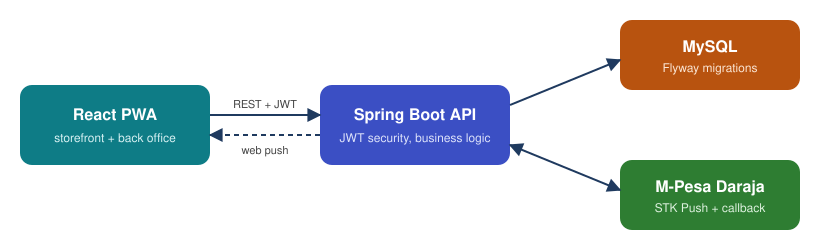

<div align="center">

# 🍼 AMIR BabyShop

**A full-stack online store for baby clothes, toys and essentials, with M-Pesa payments, order tracking and a baby gift registry.**


</div>

---

## About

AMIR BabyShop is a live e-commerce platform built for a baby shop in Mombasa, Kenya. Parents can browse products, pay with M-Pesa and track their orders, while the shop team manages stock, orders and customers from a role-based back office.

## Highlights

- 💳 **M-Pesa payments** with STK Push and idempotent callbacks, plus a manual paybill option
- 📦 **Order tracking** with a stage timeline, including guest checkout and tracking
- 🎁 **Baby registry:** create one, share a link, and let friends and family gift items
- ⭐ **Reviews and ratings**, a wishlist, coupons and multi-currency prices
- 🔔 **Notifications** in the app and by web push
- 👥 **Role-based staff tools** for inventory, orders, returns and analytics

## Architecture

<div align="center">



</div>

## Tech Stack

| Layer | Tools |
|---|---|
| Frontend | React, React Router, Tailwind CSS, Context API |
| Backend | Java 21, Spring Boot, Spring Security (JWT), Spring Data JPA |
| Database | MySQL, Flyway migrations |
| Integrations | M-Pesa Daraja, Web Push |

## Getting Started

```bash
# Backend (Java 21, Maven, MySQL): add a .env file with your settings first
cd backend && mvn spring-boot:run

# Frontend
cd frontend && npm install && npm run dev
```

> Keep secrets (database, JWT, M-Pesa, push keys) in a `.env` file that is **not committed**.

---

**Ahmed Abib** · [Portfolio](https://abib-ahmed-portfolio.onrender.com) · [LinkedIn](https://www.linkedin.com/in/ahmed-abib-5b37a5184)
